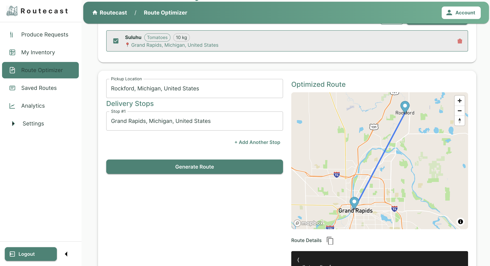

# Croprithm

## Mobile-web delivery pilot

Croprithm handles delivery planning and operator-confirmed progress. Google Maps
and Apple Maps handle turn-by-turn navigation; no native mobile app, embedded
navigation SDK, background GPS or automatic proof of delivery is provided.

1. Accept produce requests, then open Route Planner.
2. Select accepted orders, choose **Use Selected as Stops**, and enter a pickup
   and route name. **Generate Route** shows an unsaved preview (manual addresses
   also work). **Save selected orders for delivery** optimizes and saves today's
   accepted-order itinerary to the backend.
3. Open Google Maps or Apple Maps for a pickup or delivery stop. Coordinate
   destinations are preferred; addresses are used when coordinates are missing
   or invalid. The navigation provider starts from the user's current location
   and may choose different roads, traffic estimates and arrival times.
4. Return to Croprithm while safely parked to record **En route**, **Arrived**,
   **Mark delivered**, **Skip stop**, or **Reset**. Opening Maps does not update
   progress. Resume a saved itinerary from **Saved Routes > View Details**.
5. Complete a route only after every stop is delivered. Skipped stops remain
   unresolved; cancelled/completed routes cannot accept progress updates.

An internet connection is required to save/load progress. Manual-address previews
are not persistent. Saving selected orders recalculates their itinerary; inspect
the saved order before navigation. Orders on non-cancelled routes cannot be
scheduled again. Re-optimization is limited to planned routes with no recorded progress.
All selected addresses must geocode successfully; failures no longer silently
omit deliveries. Identical addresses retain separate order/stop identities.

Stop progress is separate from order acceptance and does not automatically
confirm fulfillment in Menurithm. Reliable cross-app delivery confirmation,
offline synchronization, real-device pilot validation and native-app decisions
are tracked in the [Croprithm Pilot Roadmap](https://github.com/users/brianmbeere/projects/3).
Existing route metrics are planning estimates; assumed savings are not measured
pilot outcomes. Passenger-car Maps directions are not truck-clearance routing.

### Regression checks

From the backend, using its configured Python environment:

```bash
python -m unittest test_delivery_workflow test_database_config -q
```

From the frontend (Node 22.6+ for the built-in TypeScript test runner):

```bash
node --experimental-strip-types --test tests/navigation.test.mjs
VITE_BACKEND_URL=https://api.croprithm.com npm run build
```

For a credential-free visual check, run the Vite development server and open
`/tests/itinerary.html`. This fixture uses in-memory fake deliveries, never calls
the delivery backend, and is not included in the production build. Check details
opening, provider links, progress, rejected premature completion and narrow
screens. Actual Google/Apple app switching still needs real-device validation.

## Rebrand and custom domain rollout

The canonical repository is [brianmbeere/croprithm](https://github.com/brianmbeere/croprithm).
The local checkout is now named `croprithm`. Public branding uses Croprithm.
The free static hostname is `croprithm.onrender.com`; the intended primary domain
is `croprithm.com`, with `www.croprithm.com` redirecting to the root.

GoDaddy DNS records for the Render services:

| Type | Host | Value |
| --- | --- | --- |
| A | @ | 216.24.57.1 |
| CNAME | www | croprithm.onrender.com |
| CNAME | api | routecast-core.onrender.com |

Remove conflicting parking A/AAAA records for these hosts only; preserve mail
and verification records. Add the root domain to the Croprithm static site
(Render adds its www redirect) and `api.croprithm.com` to the existing API.
DNS, Render domain verification and HTTPS have been verified for all three
custom hostnames. `VITE_BACKEND_URL` now uses `https://api.croprithm.com`.
The existing assigned API hostname remains a deliberate compatibility URL.
Renaming a Render service does not change its assigned hostname.

Keep the existing Firebase project `routecast-49fd2`: rename its display name to
Croprithm in Project settings, and update the web app nickname and authentication
email-template sender/app names as appropriate. In Authentication > Settings >
Authorized domains, add `croprithm.com`, `www.croprithm.com` and
`croprithm.onrender.com`. Retain old authorized domains through the transition.
Review Firebase API-key referrer restrictions and Mapbox allowed URLs for these
origins. Do not change `VITE_FIREBASE_PROJECT_ID`, the Firebase auth domain or
Admin credentials merely to change the brand; users and tokens belong to the
existing project. A new project would require a separate account/data migration.

The existing PostgreSQL logical database `routecast`, role `routecast_api`,
Firebase project ID and historical backups intentionally retain legacy names.
They are internal identities, not public branding; renaming them is not needed
and could break access or lose history. No new paid API or database is required.
Static compute remains free; workspace build/bandwidth and custom-domain quotas
still apply.

Croprithm is a data-driven logistics decision-support platform designed to assist local food producers and restaurants with delivery planning and route coordination. The system supports regional food distribution by transforming operational inputs into optimized delivery routes that can be reviewed and executed by human operators.



---

## Overview

Small and mid-scale food producers often rely on manual planning to coordinate deliveries to multiple restaurant clients. Croprithm supports this planning process by allowing users to define pickup locations, delivery destinations, and accepted produce requests, and then generating optimized route suggestions based on real road-network distance data.

The platform is designed to **support human decision-making**, not to automate logistics execution.

---

## Core Capabilities

- Multi-stop delivery route planning from a single pickup location  
- Route optimization using real road-network distance calculations  
- Interactive map-based visualization of suggested routes  
- Integration with produce request and inventory workflows  
- Historical tracking of planned and completed delivery routes  

---

## Route Planning Workflow

1. A producer selects a pickup location and one or more delivery destinations  
2. Croprithm retrieves distance and travel duration data using routing services
3. A deterministic optimization heuristic orders delivery stops to reduce total travel distance  
4. The suggested route is displayed visually for operator review  
5. Operators may save, reuse, or execute routes based on operational needs  

The screenshot above illustrates a typical route planning scenario with a pickup location and delivery stop rendered on the map interface.

---

## Architecture (High-Level)

### Backend
- Python-based backend implemented using FastAPI  
- Structured relational data storage using PostgreSQL and SQLAlchemy  
- External routing services used for distance and duration calculations  
- Authentication and access control handled via Firebase token verification  

### Frontend
- Web-based client built using TypeScript and Preact  
- Interactive route visualization using Mapbox GL JS  
- Role-based user flows for producers and restaurant users  

### Shared Render Postgres pilot

Croprithm and Menurithm can share one Render Postgres instance using separate
logical databases. Both define a `users` table, so **do not point them at the
same logical database**.

1. Connect with the Render dashboard's PSQL command (owner role, direct port 5432)
   and run `CREATE DATABASE routecast_pilot;` once. Menurithm should use its own
   `menurithm_pilot` database on that instance. Database creation is an
   administrative step, not API startup work.
2. On Croprithm's Render service, set `DATABASE_URL` to the instance's internal
   URL and `DB_NAME=routecast_pilot`. Set `DB_NAME=menurithm_pilot` on Menurithm.
   Keep services in the same region as Postgres. A full unique URL ending in
   `/routecast_pilot` also works with `DB_NAME` unset.
3. From Croprithm's backend directory, run `python migrate_db.py` using the same
   environment before serving traffic. This imports the central engine and
   creates missing tables; it does not create the database or migrate existing
   columns. Croprithm does not create tables in its main module.
4. Back up and restore existing data into the appropriate target before cutover;
   changing the URL does not copy data. Validate each application's data before
   retiring old instances.

[`backend/app/core/database_config.py`](backend/app/core/database_config.py)
loads `.env` without overriding Render environment variables and parses the URL
with SQLAlchemy. Optional `DB_NAME` replaces only its database path, preserving
credentials and query parameters; it takes precedence over the path. It accepts
1-63 lowercase ASCII letters, digits or underscores, starting with a letter or
underscore. Empty/invalid overrides, non-Postgres overrides and conflicting
`dbname` query parameters fail explicitly. Legacy `postgres://` is normalized.
Use service-specific DB_NAME values, not a common value in a shared environment
group. Never commit real connection URLs.

The central engine in
[`backend/app/db/database.py`](backend/app/db/database.py) uses these PostgreSQL
pool settings per worker process:

| Variable | Default |
| --- | --- |
| `DB_POOL_SIZE` | `2` |
| `DB_MAX_OVERFLOW` | `1` |
| `DB_POOL_TIMEOUT` | `30` seconds |
| `DB_POOL_RECYCLE` | `1800` seconds |

`pool_pre_ping=True` replaces stale connections on checkout, not interrupted
transactions. Connections open lazily. Settings must be integers; pool size,
timeout and recycle must be positive, and overflow must be nonnegative.
Non-Postgres engine options are unchanged. Keep request sessions closed using
the existing `get_db()` dependency.

Two single-worker APIs have a combined ceiling of six application connections
with these defaults. Multiply by worker and replica counts, and reserve capacity
for deployments, background jobs, migrations and administration. Render's
[$7 Starter Postgres is a legacy plan](https://render.com/docs/postgresql-legacy-instance-types)
with 97 connections shared by all logical databases, 256 MB RAM, 0.1 CPU and
1 GB storage; it is not offered for new instances. Verify the actual plan and
`SHOW max_connections;`, then monitor CPU, memory, storage and pool waits.

To verify the selected database from the backend directory:

```bash
python - <<'PY'
from sqlalchemy import text
from app.core.database_config import create_database_engine

engine = create_database_engine()
try:
    with engine.connect() as connection:
        print(connection.execute(text(
            "SELECT current_database(), current_user"
        )).one())
finally:
    engine.dispose()
PY
```

Expect `routecast_pilot`. Distinct databases prevent table collisions, but shared
owner credentials are not access-control isolation. Use separate roles and
database CONNECT permissions (including removing PUBLIC access) if required.
Resources, outages and instance-level connection limits remain shared.

Render offers optional [integrated PgBouncer](https://render.com/docs/postgresql-connection-pooling)
on paid databases at no additional cost. Bounded application pools are sufficient
to start. If enabling it, plan for a database restart, use the provided pool URL
(port 6432), and verify access to both logical databases before cutover.
Session-dependent features require direct connections; keep provisioning,
migrations and backups on direct port 5432.

### Free static frontend

The Preact frontend is a browser-only Vite SPA, not a server-rendered application.
[`render.yaml`](render.yaml) defines a free static site named `croprithm`:

- Root directory: `frontend`
- Build: `npm ci --include=dev && npm run build`
- Publish directory: `dist`
- SPA rewrite: `/*` to `/index.html` (rewrite, not redirect)
- No start command or Vite preview server

Copy the current frontend's `VITE_*` settings at **build time**, keeping
`VITE_BACKEND_URL=https://api.croprithm.com`, Firebase web configuration,
and the public Mapbox token (`VITE_MAP_BOX_API_TOKEN`, starting with `pk.`).
Changing build variables requires a rebuild. Required configuration, HTTPS API
URLs and the public Mapbox token are validated during production builds. For a
local production build with localhost development settings:

```bash
cd frontend
VITE_BACKEND_URL=https://api.croprithm.com npm run build
```

All `VITE_*` settings are public browser configuration. Do not copy database
credentials, Firebase Admin keys, Mapbox secret tokens or service API keys into
the static site's environment.

Set the backend's **`ALLOWED_ORIGINS`** to include `https://croprithm.com`,
`https://www.croprithm.com` and `https://croprithm.onrender.com`.
Add those three hostnames to
Firebase Authentication's authorized domains and any API-key referrer
restrictions; allow the new origin in the public Mapbox token's URL restrictions.
Verify maps, sign-in, API calls and direct `/signin` and `/dashboard` navigation
before suspending the old paid frontend.

The new static site uses `croprithm.com` with `croprithm.onrender.com` as a
fallback hostname. The previous free `routecast.onrender.com` site remains
available during Firebase/domain acceptance; the temporary
`routecast-static.onrender.com` staging site is retired and does not redirect.
Use the custom domain in new links and bookmarks.
Static sites avoid a monthly compute charge, but workspace bandwidth and build
minutes can still be billed. Do not create a duplicate site by applying a new
Blueprint to a manually created resource without reconciling/importing it.

For the existing production data, use `DB_NAME=routecast` on the retained
Menurithm instance and leave Menurithm on its existing `menurithm` database.
The `_pilot` names above are fresh-install examples. The inspected live instances
are Basic 256 MB, not legacy Starter: the 5 GB Menurithm instance is the smaller
consolidation target. The original 15 GB Croprithm instance was retained for
cutover acceptance, then permanently deleted with user approval after private
backup checksums and active applications were verified.

#### Verified live layout (2026-10-18)

The active frontend is https://croprithm.com (also https://croprithm.onrender.com), deploying from
this repository's `main` branch with the static settings in
[`render.yaml`](render.yaml). The public API is https://api.croprithm.com;
https://routecast-core.onrender.com remains a compatibility hostname.
Live Render settings match the YAML;
changing YAML alone does not attach a manually created site to Blueprint sync.

The API now connects to **`shared-pilot-postgres`** with
`DB_NAME=routecast`, a URL ending in `/routecast`, and the dedicated
`routecast_api` login. Its pool is explicitly set to 2 retained connections,
1 overflow, a 30-second timeout and 1800-second recycling. Menurithm remains on
the separate `menurithm` logical database.

Both APIs were paused before cutover backups. The restored Croprithm tables
matched source row counts, content digests and sequence values. Live
database-backed API reads, CORS for the static origin, SPA deep links, assets,
and Mapbox origin access were verified. The user accepted both new frontends
before the old paid frontends were suspended.

The original Croprithm Postgres instance and both old paid frontend services are
**permanently deleted**, following explicit user approval. Both APIs, static sites
and database reads were verified again after deletion. Approximately $20/month
of compute plus the old database's allocated storage charges were removed at
current published rates. The active shared instance and logical databases are
unchanged.

The clean `croprithm.onrender.com` URL now serves the free static frontend. The
deleted database's Render-managed recovery history is no longer available.
Private PostgreSQL 16 cutover dumps remain, with checksums verified before
deletion, but do not track newer writes. Recovery into another instance requires
provisioning a target and restoring a backup; pause writers and reconcile current
data instead of overwriting newer writes with a stale cutover dump.

Firebase's public configuration now confirms `croprithm.com`,
`www.croprithm.com` and `croprithm.onrender.com` as authorized domains in the
existing `routecast-49fd2` project (number `589507409368`). Existing accounts
and project identity are retained. Provider-specific OAuth and email-link flows
still require their own end-to-end sign-in checks. The existing local
Firebase service-account key could not obtain a Google management token; do not
reuse it for deployment administration. Never put a replacement private key in
the frontend or commit one to this repository.

#### Shared infrastructure ownership

The retained database instance is now named
[`shared-pilot-postgres`](https://dashboard.render.com/d/dpg-d1b9okidbo4c73cal3o0-a)
and belongs to **Shared Infrastructure / Production**, not either application's
project. Croprithm and Menurithm keep their separate app projects and
GitHub-linked deployments. The original Croprithm database and both old paid
frontends have been removed; the app projects contain only their active API and
static site.

The shared instance contains the separate `menurithm` and `routecast` logical
databases. This was only a display-name/project move: the instance ID, existing
hostnames, credentials and URLs did not change. Keep `DB_NAME=routecast` and the
`routecast_api` login on this API. Do not substitute the display name for the
database name or hostname in connection strings.

Shared Infrastructure / Production permits cross-environment private networking,
as do both app environments. Both APIs continue using their existing internal
URLs in Oregon. Review both applications before enabling network isolation.
Keep their database selection and credentials service-specific.

The shared database is intentionally absent from both app repositories'
static-site Blueprints: it must have one infrastructure owner, not be created or
managed twice. Future infrastructure-as-code adoption should import the existing
instance into one dedicated infrastructure definition, not provision a new
database per app.

---

## Analytics and Operational Visibility

Croprithm records operational data associated with delivery planning, including:
- Number of delivery stops per route  
- Estimated travel distance  
- Route execution history  

These records support basic operational analysis and can be exported for reporting or review.

---

## Integration

Croprithm is designed to interoperate with food service planning platforms such as **Menurithm**. Accepted produce requests and delivery-related data can be shared between systems through API-based integration, supporting coordinated planning across food preparation and logistics activities.

---

## Status

This repository contains an actively developed implementation of the Croprithm platform. The system is designed for real-world operational use and ongoing iterative refinement.

---

## Author

**Brian Mbeere**  
Software Engineer focused on data-driven decision-support systems for food operations and logistics planning.
